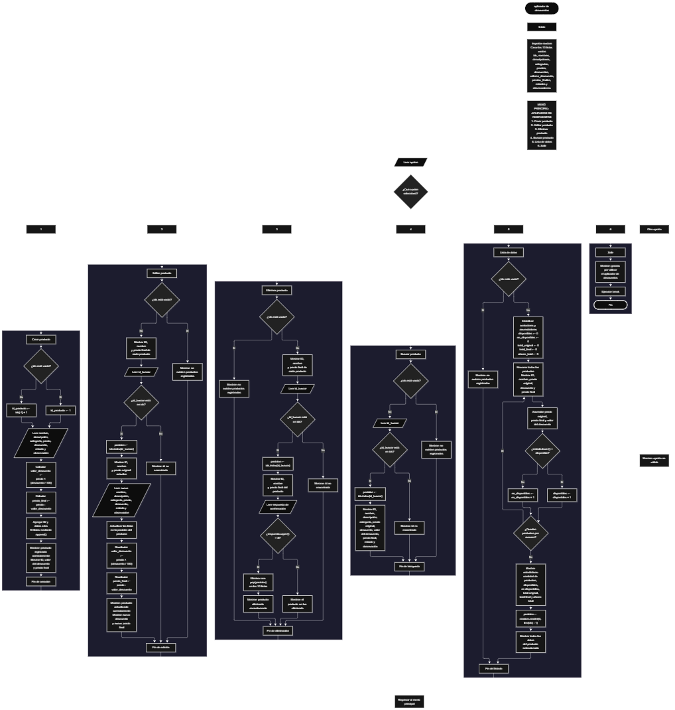

 

<p align="justify">Este proyecto, llamado <b>aplicador de descuentos</b>, fue desarrollado en <b>python</b> como un ejercicio práctico para fortalecer la lógica de programación mediante la creación de un sistema de gestión de productos desde la consola. El programa cuenta con un menú principal de seis opciones que permite <b>crear, editar, eliminar, buscar, listar y consultar información de los productos registrados</b>. Cada producto almacena datos como el nombre, la descripción, la categoría, el precio original, el porcentaje de descuento, el valor descontado, el precio final, el estado y las observaciones. Para organizar esta información, se utilizan diez listas paralelas que mantienen los datos relacionados mediante sus posiciones e identificadores. Durante su desarrollo se aplicaron conceptos fundamentales de programación, como variables, listas, estructuras condicionales, ciclos repetitivos, operaciones aritméticas, búsqueda de registros y métodos para agregar, modificar y eliminar elementos. Además, el programa calcula estadísticas sobre los precios y los ahorros generados, y utiliza el módulo <b>random</b> para seleccionar aleatoriamente un producto registrado. Este proyecto permite poner en práctica los conocimientos adquiridos en python y sirve como base para desarrollar sistemas de gestión de productos más completos.</p>

<h2 align="center">⚙️ Funcionamiento del menú principal</h2>

### ➕ Crear producto

<p align="justify">La opción <b>1) crear producto</b> permite registrar un nuevo producto en el sistema. Primero, el programa comprueba si la lista <b>ids</b> está vacía. Si no existen productos registrados, asigna el identificador <b>1</b> mediante la variable <b>id_producto</b>. En caso contrario, genera el siguiente identificador sumando uno al último ID almacenado, utilizando la expresión <b>ids[-1] + 1</b>. Después, solicita el nombre, la descripción, la categoría, el precio original, el porcentaje de descuento, el estado y la observación del producto. Para calcular el descuento, utiliza la operación <b>precio * (descuento / 100)</b>, y posteriormente obtiene el precio final mediante la resta del valor del descuento al precio original. Los datos se almacenan en sus respectivas listas utilizando el método <b>append()</b>. Finalmente, muestra el mensaje <b>"producto registrado correctamente."</b>, el identificador asignado, el valor monetario del descuento y el precio final con dos decimales. El código actual no incluye una validación explícita para impedir precios negativos o porcentajes de descuento fuera del rango habitual de 0 a 100.</p>

### ✏️ Editar producto

<p align="justify">La opción <b>2) editar producto</b> permite modificar los datos de un producto registrado. Primero, el programa comprueba si existen productos almacenados mediante la condición <b>len(ids) == 0</b>. Si no hay registros, muestra el mensaje <b>"no existen productos registrados."</b>. En caso contrario, presenta una lista con el identificador, el nombre y el precio final de cada producto. Después, solicita el ID del producto que se desea editar y comprueba si se encuentra dentro de la lista <b>ids</b>. Si existe, utiliza el método <b>index()</b> para localizar su posición y muestra el identificador, el nombre y el precio original actuales. A continuación, solicita el nuevo nombre, la descripción, la categoría, el precio, el porcentaje de descuento, el estado y la observación. Los datos se actualizan directamente en sus respectivas listas. Una vez modificados el precio y el porcentaje de descuento, el programa vuelve a calcular el valor descontado y el precio final. Finalmente, presenta el mensaje <b>"producto actualizado correctamente."</b> e informa el nuevo valor del descuento y el precio final. Si el ID introducido no existe, muestra el mensaje <b>"id no encontrada."</b>.</p>

### 🗑️ Eliminar producto

<p align="justify">La opción <b>3) eliminar producto</b> permite eliminar un producto registrado mediante su identificador. Antes de comenzar, el programa comprueba si existen productos almacenados. Si la lista está vacía, muestra el mensaje <b>"no existen productos registrados."</b>. Si hay productos disponibles, presenta una lista con sus identificadores, nombres y precios finales. Después, solicita el ID del producto que se desea eliminar y comprueba si está registrado. Si lo encuentra, utiliza <b>index()</b> para localizar su posición y muestra el identificador, el nombre y el precio final del producto seleccionado. A continuación, solicita una confirmación mediante la pregunta <b>"¿desea eliminar este producto? (s/n):"</b>. Si la respuesta, convertida a mayúsculas mediante <b>upper()</b>, es igual a <b>"S"</b>, el programa utiliza el método <b>pop(posicion)</b> para eliminar el elemento correspondiente de las diez listas: <b>ids, nombres, descripciones, categorias, precios, descuentos, valores_descuento, precios_finales, estados y observaciones</b>. Finalmente, muestra el mensaje <b>"producto eliminado correctamente."</b>. Si el usuario no confirma la eliminación, presenta el mensaje <b>"el producto no fue eliminado."</b>. Si el identificador no existe, muestra <b>"id no encontrada."</b>. La eliminación mantiene sincronizadas las posiciones de las listas para conservar la relación entre los datos de cada producto.</p>

### 🔎 Buscar producto

<p align="justify">La opción <b>4) buscar producto</b> permite localizar un producto mediante su identificador. Primero, el programa comprueba si existen productos registrados. Si no hay datos almacenados, muestra el mensaje <b>"no existen productos registrados."</b>. En caso contrario, solicita el ID del producto que se desea buscar y comprueba si está presente en la lista <b>ids</b>. Cuando encuentra una coincidencia, utiliza <b>index()</b> para obtener la posición del producto y mostrar toda su información: identificador, nombre, descripción, categoría, precio original, porcentaje de descuento, valor del descuento, precio final, estado y observación. Los valores monetarios se presentan con dos decimales mediante la función <b>format()</b>. Si el identificador introducido no corresponde a ningún producto registrado, muestra el mensaje <b>"id no encontrada."</b>. Esta función permite consultar los datos de un producto específico sin necesidad de recorrer visualmente toda la lista de registros.</p>

### 📋 Lista de datos

<p align="justify">La opción <b>5) lista de datos</b> permite visualizar los productos registrados y calcular estadísticas relacionadas con sus precios, descuentos y estados. Primero, el programa comprueba si existen productos almacenados. Si la lista está vacía, muestra el mensaje <b>"no existen productos registrados."</b>. Si hay registros disponibles, inicializa los contadores <b>disponibles</b> y <b>no_disponibles</b>, junto con los acumuladores <b>total_original, total_final y ahorro_total</b>. Después, utiliza un ciclo <b>for</b> para recorrer los productos y mostrar el identificador, el nombre, el precio original, el porcentaje de descuento y el precio final. Durante el recorrido, acumula los precios originales, los precios finales y los valores de los descuentos. También comprueba el estado de cada producto utilizando el método <b>lower()</b>: los estados iguales a <b>"disponible"</b> se contabilizan como disponibles, mientras que cualquier otro valor se cuenta como no disponible. Al finalizar, presenta la cantidad total de productos, el número de productos disponibles y no disponibles, el valor total sin descuentos, el valor total con descuentos y el ahorro total generado. Finalmente, utiliza <b>random.randint(0, len(ids) - 1)</b> para seleccionar una posición aleatoria entre los productos registrados y mostrar toda la información del producto seleccionado. Esta selección se realiza cada vez que se ejecuta la opción y no modifica los registros almacenados.</p>

### 🚪 Salir del menú principal

<p align="justify">La opción <b>6) salir</b> permite finalizar la ejecución del programa. Cuando el usuario selecciona esta opción, el sistema muestra el mensaje <b>"gracias por utilizar el aplicador de descuentos."</b> y ejecuta la instrucción <b>break</b>, que interrumpe el ciclo <b>while True</b> del menú principal. De esta manera, el programa termina su ejecución después de mostrar el mensaje de despedida.</p>

<h2 align="center">🧠 Temas aplicados en el proyecto</h2>

### 📦 Variables

<p align="justify">En este proyecto se utilizan variables para almacenar temporalmente los datos introducidos por el usuario, controlar los identificadores, localizar productos, calcular descuentos, obtener precios finales y generar estadísticas. Cada variable cumple una función específica dentro de las operaciones de gestión de productos y permite realizar los cálculos necesarios para el funcionamiento del sistema.</p>

🔢 **Opcion:** Almacena la opción seleccionada por el usuario en el menú principal.

🆔 **Id_producto:** Almacena el identificador asignado al nuevo producto.

🔎 **Id_buscar:** Guarda el identificador introducido para localizar un producto durante las operaciones de edición, eliminación y búsqueda.

📍 **Posicion:** Almacena el índice del producto localizado dentro de las listas.

💰 **Precio:** Almacena el precio original del producto.

📉 **Descuento:** Guarda el porcentaje de descuento aplicado al precio original.

💵 **Valor_descuento:** Almacena el valor monetario que se resta al precio original.

💲 **Precio_final:** Guarda el precio del producto después de aplicar el descuento.

📊 **Disponibles y no_disponibles:** Cuentan los productos según el estado registrado.

🧮 **Total_original, total_final y ahorro_total:** Acumulan los precios originales, los precios finales y los valores monetarios de los descuentos de los productos registrados.

🔄 **I:** Funciona como contador en el ciclo que recorre los productos durante la edición, la eliminación y la generación de estadísticas.

### 🗃️ Listas

<p align="justify">En este proyecto se utilizan diez listas paralelas para almacenar la información de los productos. Cada lista conserva un tipo de dato específico y utiliza el mismo índice para relacionar la información correspondiente a un producto. Por ejemplo, los datos del producto ubicado en la posición <b>0</b> se encuentran distribuidos entre <b>ids[0], nombres[0], precios[0], descuentos[0]</b> y las demás listas relacionadas. Esta organización permite agregar, localizar, modificar, mostrar y eliminar productos mediante una posición común, manteniendo la correspondencia entre sus datos.</p>

🆔 **Ids:** Almacena los identificadores de los productos registrados.

📝 **Nombres:** Guarda los nombres de los productos.

📄 **Descripciones:** Almacena las descripciones de los productos.

🗂️ **Categorias:** Guarda las categorías correspondientes a cada producto.

💰 **Precios:** Almacena los precios originales de los productos.

📉 **Descuentos:** Guarda los porcentajes de descuento aplicados.

💵 **Valores_descuento:** Almacena los valores monetarios calculados para cada descuento.

💲 **Precios_finales:** Guarda los precios resultantes después de aplicar los descuentos.

📦 **Estados:** Almacena los estados registrados para los productos.

📌 **Observaciones:** Guarda las observaciones adicionales de cada producto.

### ➕ Operaciones aritméticas

<p align="justify">Las operaciones aritméticas se utilizan para calcular el valor monetario del descuento y el precio final de cada producto. El porcentaje de descuento se divide entre <b>100</b> para convertirlo en una proporción, que posteriormente se multiplica por el precio original. Después, el valor del descuento se resta del precio original para obtener el precio final. Estas operaciones se ejecutan tanto durante el registro como durante la edición de los productos.</p>

```python
valor_descuento = precio * (descuento / 100)
precio_final = precio - valor_descuento
```

### 🔀 Estructuras condicionales

<p align="justify">En este proyecto se utilizan las estructuras <b>if, elif y else</b> para controlar las opciones del menú principal y determinar qué operación debe ejecutarse. También permiten comprobar si existen productos registrados, verificar si un identificador se encuentra en la lista de IDs, confirmar la eliminación de un producto y clasificar los registros según su estado. Estas condiciones permiten que el programa responda de manera diferente dependiendo de la información almacenada y de las decisiones del usuario.</p>

### 🔄 Estructuras repetitivas

<p align="justify">El programa utiliza los ciclos <b>while</b> y <b>for</b>. El ciclo <b>while True</b> mantiene activo el menú principal hasta que el usuario selecciona la opción de salida y se ejecuta <b>break</b>. Por otra parte, los ciclos <b>for</b> recorren las listas para presentar los productos durante la edición y la eliminación, así como para generar la lista general y calcular las estadísticas. De esta manera, el sistema puede trabajar con todos los productos registrados sin necesidad de escribir instrucciones individuales para cada uno.</p>

### 🎯 Selección de opciones

<p align="justify">El programa utiliza una estructura condicional formada por <b>if, elif y else</b> para evaluar la variable <b>opcion</b>. Cada alternativa corresponde a una operación del menú principal: crear, editar, eliminar, buscar, listar datos o salir. Si el valor introducido no coincide con ninguna de las opciones definidas, se ejecuta el bloque <b>else</b> y se muestra el mensaje <b>"opción no válida."</b>. Esta estructura permite organizar las funcionalidades del sistema y controlar la navegación entre las distintas operaciones.</p>

### 🔍 Búsqueda por identificador

<p align="justify">La búsqueda de productos se realiza mediante la lista <b>ids</b> y los métodos <b>in</b> e <b>index()</b>. Primero, el programa comprueba si el identificador introducido se encuentra registrado. Si existe, utiliza <b>index()</b> para obtener la posición correspondiente y acceder a los datos del producto en las demás listas. Este procedimiento se utiliza en las operaciones de edición, eliminación y búsqueda, evitando tener que localizar manualmente los registros relacionados.</p>

### 🧮 Generación de identificadores

<p align="justify">El programa genera identificadores automáticamente al crear nuevos productos. Si no existen registros, asigna el número <b>1</b>. Si ya hay productos almacenados, obtiene el último identificador mediante <b>ids[-1]</b> y le suma uno. Este procedimiento permite asignar IDs consecutivos de acuerdo con el último elemento de la lista. Sin embargo, el sistema no utiliza un contador independiente para conservar el último ID utilizado; por ello, si se elimina el último producto registrado, el identificador eliminado podría volver a asignarse en una creación posterior.</p>

### 🎲 Selección aleatoria de productos

<p align="justify">El programa utiliza el módulo <b>random</b> para seleccionar aleatoriamente un producto durante la opción de lista de datos. La instrucción <b>random.randint(0, len(ids) - 1)</b> genera un número entero dentro del rango de índices válidos de la lista. El número obtenido se almacena en la variable <b>posicion</b> y permite mostrar toda la información del producto seleccionado. Esta operación solo se ejecuta cuando existen productos registrados, por lo que el programa evita realizar la selección aleatoria cuando las listas están vacías.</p>

### 💲 Formato de valores monetarios

<p align="justify">Para presentar los precios originales, los valores de descuento y los precios finales, el programa utiliza la función <b>format()</b> con el formato <b>".2f"</b>. Esta instrucción muestra los valores numéricos con dos cifras decimales, facilitando la lectura de las cantidades monetarias. También se emplean las cadenas formateadas <b>f-strings</b> para presentar los datos de los productos en una misma línea durante las operaciones de edición, eliminación y listado.</p>

### 🔠 Tratamiento de cadenas de texto

<p align="justify">El programa utiliza los métodos <b>upper()</b> y <b>lower()</b> para realizar determinadas comparaciones sin depender de las mayúsculas o minúsculas introducidas. Durante la eliminación, <b>upper()</b> permite aceptar la confirmación escrita como <b>"s"</b> o <b>"S"</b>. Durante la generación de estadísticas, <b>lower()</b> permite reconocer el estado <b>"disponible"</b> aunque se introduzca con diferentes combinaciones de mayúsculas y minúsculas. Esta normalización se aplica únicamente a esas comparaciones y no modifica permanentemente los textos almacenados.</p>

<h2 align="center">¿Cómo se implementaron las operaciones crud en el proyecto?</h2>

<p align="justify">Las operaciones <b>crud</b> se implementaron mediante las opciones del menú principal, permitiendo administrar los productos registrados en el sistema. La operación <b>crear</b> corresponde a <b>crear producto</b>, donde se introducen los datos de un nuevo producto y se calculan su descuento y precio final. La operación <b>leer</b> se realiza mediante las opciones <b>buscar producto y lista de datos</b>, que permiten consultar un registro específico o visualizar todos los productos y sus estadísticas. La operación <b>actualizar</b> corresponde a <b>editar producto</b>, donde se modifican los datos de un producto y se recalculan sus valores monetarios. Finalmente, la operación <b>eliminar</b> se realiza mediante <b>eliminar producto</b>, que solicita confirmación antes de retirar los datos correspondientes de las listas. Estas operaciones utilizan listas paralelas, identificadores, condicionales y ciclos para administrar la información durante la ejecución del programa.</p>

<h2 align="center">Diagrama de flujo del proyecto</h2>



<h2 align="center">🛡️ Validaciones del programa</h2>

### 📭 No existen productos registrados

<p align="justify">Esta comprobación se utiliza en las opciones de <b>editar, eliminar, buscar y lista de datos</b>. El programa evalúa la condición <b>len(ids) == 0</b> para determinar si hay productos almacenados. Si la lista está vacía, muestra el mensaje <b>"no existen productos registrados."</b> y no continúa con la operación solicitada. Esta comprobación también evita que la opción de listado intente seleccionar un producto aleatorio cuando no hay registros disponibles.</p>

### ❌ Identificador no encontrado

<p align="justify">Esta comprobación se utiliza durante las operaciones de edición, eliminación y búsqueda. El programa verifica si el ID introducido se encuentra en la lista <b>ids</b>. Si existe, utiliza <b>index()</b> para localizar la posición del producto y acceder a sus datos. Si no se encuentra, muestra el mensaje <b>"id no encontrada."</b>. De esta manera, el programa evita modificar o eliminar un producto que no está registrado.</p>

### ❓ Confirmación de eliminación

<p align="justify">Antes de eliminar un producto, el programa muestra sus datos principales y solicita una confirmación mediante una respuesta de tipo texto. La condición <b>respuesta.upper() == "S"</b> determina si se ejecuta la eliminación. Si la respuesta es <b>"s"</b> o <b>"S"</b>, el producto se elimina de las diez listas. En caso contrario, muestra el mensaje <b>"el producto no fue eliminado."</b>. La condición actual interpreta cualquier respuesta distinta de <b>"S"</b> como una negativa, sin solicitar nuevamente la confirmación.</p>

### ⚠️ Opción no válida

<p align="justify">El bloque <b>else</b> del menú principal se ejecuta cuando el usuario introduce una opción diferente de los valores comprendidos entre <b>"1"</b> y <b>"6"</b>. En ese caso, muestra el mensaje <b>"opción no válida."</b> y el ciclo <b>while True</b> permite volver a presentar el menú para seleccionar otra operación.</p>

### 🔢 Entrada de datos numéricos

<p align="justify">El programa utiliza <b>int()</b> para convertir el identificador introducido durante las operaciones de edición, eliminación y búsqueda, y utiliza <b>float()</b> para convertir los precios y porcentajes de descuento. Sin embargo, el código actual no incluye bloques <b>try-except</b> ni otras comprobaciones para gestionar entradas no numéricas. Por ello, si el usuario introduce un valor que no puede convertirse al tipo numérico solicitado, el programa puede finalizar debido a un error de conversión.</p>

### 💰 Precios y porcentajes de descuento

<p align="justify">El sistema calcula el valor del descuento y el precio final a partir del precio original y del porcentaje introducido. No obstante, el código actual no comprueba explícitamente si el precio es positivo ni si el porcentaje de descuento se encuentra entre <b>0 y 100</b>. Por esta razón, los cálculos pueden realizarse con precios negativos o porcentajes fuera de ese rango. La implementación actual efectúa las operaciones aritméticas con los valores numéricos recibidos, sin aplicar restricciones adicionales.</p>

### 📦 Estados de los productos

<p align="justify">Durante la generación de estadísticas, el programa considera disponible un producto cuyo estado, después de aplicar <b>lower()</b>, coincide exactamente con <b>"disponible"</b>. Cualquier otro valor se contabiliza como no disponible. Aunque al registrar un producto se solicita el estado <b>"disponible o no disponible"</b>, el código actual no verifica que la respuesta corresponda exclusivamente a uno de esos dos valores.</p>

### 💾 Almacenamiento temporal

<p align="justify">Los datos de los productos se almacenan en listas creadas en memoria al iniciar el programa. Esto permite realizar las operaciones de creación, edición, eliminación, búsqueda y listado durante la ejecución. Sin embargo, no se implementa almacenamiento en archivos ni en bases de datos. Por ello, los productos registrados no se conservan automáticamente después de finalizar el programa.</p>

<h2 align="center">🎯 Objetivo del proyecto</h2>

<p align="justify">El objetivo principal de este proyecto es fortalecer la <b>lógica de programación</b> mediante el desarrollo de un sistema de gestión de productos con aplicación de descuentos en <b>python</b>. A través de su construcción se busca aplicar conocimientos sobre variables, listas, estructuras condicionales, ciclos repetitivos, operaciones aritméticas, búsqueda de registros y manipulación de datos. Además, el proyecto permite comprender cómo calcular descuentos y precios finales, administrar productos mediante operaciones <b>crud</b> y generar estadísticas a partir de la información almacenada. De esta manera, se establece una base para desarrollar sistemas de gestión comercial más completos, incorporando posteriormente validaciones adicionales y mecanismos de almacenamiento permanente.</p>

